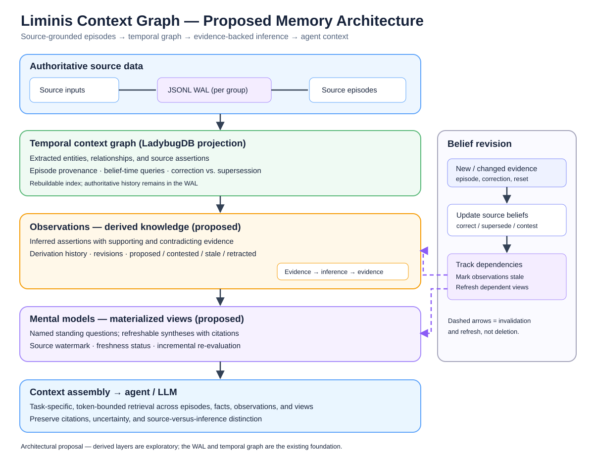

# Evidence-backed observations and mental models

**Status:** Architectural exploration



The diagram illustrates the proposed layering and the dependency-driven belief-revision loop. It is a vector recreation of the architectural illustration.

## Thesis

Keep Liminis Context Graph's append-only JSONL WAL, episode-backed assertions, rebuildable LadybugDB indexes, belief-time semantics, correction/document supersession distinction, and group-isolated streams as the source-grounded substrate. Explore an additional layer of **derived observations**, **materialized mental models**, and **task-specific context assembly**.

## Layers

| Layer | Meaning |
| --- | --- |
| Episode | What was recorded or said |
| Extracted assertion | What a source claimed |
| Observation | What was inferred across evidence |
| Mental model | Refreshable answer to a standing question |
| Context assembly | Evidence-backed information relevant to an agent's task |

A context graph is an epistemic substrate, not the entire memory lifecycle.

## Observations

An observation is a first-class derived assertion, not an ordinary extracted fact. Include a statement, type (hypothesis/generalization/conclusion/preference), subject references, supporting **and contradicting** evidence references, derivation metadata (model/rule version, time, rationale), status (proposed/accepted/contested/stale/retracted), and revision lineage.

For example, project notes documenting several React decisions may support *“The team appears to prefer React for UI work.”* The inference must not be presented as a direct source statement. Allow observation-to-observation dependencies but preserve traceability to source episodes; prevent cycles and duplicate evidence masquerading as independent corroboration. Numeric confidence is not a replacement for evidence.

## Belief revision

Distinguish:
- **Correction:** earlier source evidence was erroneous/replaced.
- **Supersession:** earlier decision was genuinely in force until replacement, with potentially different effective and recording times.
- **Contradiction:** live sources disagree without automatic arbitration.
- **Inference revision:** evidence or reasoning for an observation changes.

Source corrections, removals, supersessions, and WAL generation resets should locate dependent observations and mark them potentially stale for re-evaluation, not automatically delete or negate them. Multiple independent supports may survive. Temporal reads should distinguish what was believed then, what was in force then, and what current evidence suggests about the past.

## Mental models

Treat a mental model as a **materialized view**, not an independent authoritative fact store: a named standing question, scope, evidence-backed synthesis, refresh policy, WAL generation/watermark, citations, and freshness status.

Example:

```yaml
id: project-architecture
question: What is the project's current architecture, decisions, and open issues?
scope: project
inputs: [episodes, assertions, observations]
refresh: on-relevant-evidence-change
output: markdown
```

Prefer incremental refresh where possible.

## Context assembly

A separate read-side component constructs token-bounded, task-specific context using lexical/vector search, graph traversal, relevance, temporal constraints, provenance, source diversity, and explicit contradictions. Label source claims versus inferred observations. Retrieval rank is not belief arbitration.

## Group layering and replication

Consider storing derived observations and mental models in separate group layers connected through existing cross-group pointers, keeping upstream streams untouched. Account for re-ingestion, WAL generation changes, pointer rebinding, and downstream invalidation. LCG groups are organizational isolation, not an authorization boundary; do not assume per-group security.

## Exploratory APIs

- `knowledge_propose_observation`
- `knowledge_get_observation_evidence`
- `knowledge_find_affected_observations`
- `knowledge_revise_observation`
- `knowledge_define_mental_model`
- `knowledge_refresh_mental_model`
- `knowledge_build_context`

## Questions to resolve

1. Should observations be graph nodes, typed relationships, or independent projections?
2. How are identity, deduplication, and independent corroboration defined?
3. Should observations be auto-accepted or reviewed?
4. Which derived operations append WAL events and which are recomputed projections?
5. How do source belief time, effective time, and inference time interact?
6. What triggers recomputation after correction, supersession, cross-group changes, or WAL reset?
7. How should downstream consumers track upstream dependencies and provenance?
8. How can we measure improvement without accumulating unsupported generalizations?

## Evaluation slice

Use a small corpus of project decisions and meeting notes with corrections and contradictions. Derive one multi-source observation with evidence pointers; correct one supporting source; verify stale detection and historical `as_of` behavior. Supersede a decision with a distinct effective date. Materialize and refresh a project-status mental model. Include duplicated evidence, mistaken inference, cross-group references, WAL rebuild, and generation reset. Compare attribution, contradiction handling, retrieval quality, latency, and cost with graph-only retrieval.

## Prior art

- [Hindsight](https://docs.hindsight.vectorize.io/): evidence-backed observations and mental models.
- [Mem0](https://github.com/mem0ai/mem0): memory extraction, deduplication, and retrieval.
- [Graphiti](https://github.com/getzep/graphiti): temporal graph extraction and retrieval.

**Recommendation:** Prototype this derived-knowledge layer before modifying LCG's core graph or WAL schema.
