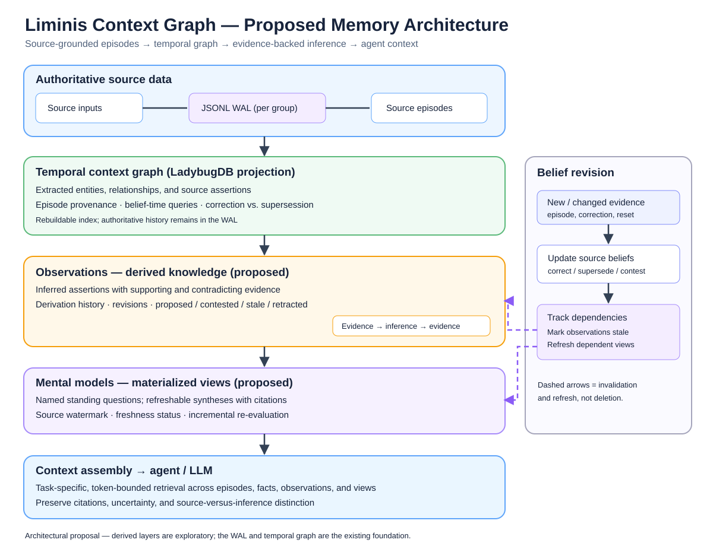

# Evidence-backed observations and mental models

**Status:** Architectural exploration



The diagram illustrates the proposed layering and the dependency-driven belief-revision loop. It is a vector recreation of the architectural illustration.

## Thesis

Keep Liminis Context Graph's append-only JSONL WAL, episode-backed assertions, rebuildable LadybugDB indexes, belief-time semantics, correction/document supersession distinction, and group-isolated streams as the source-grounded substrate. Explore an additional layer of **derived observations**, **materialized mental models**, and **task-specific context assembly**.

## Layers

| Layer | Meaning |
| --- | --- |
| Episode | What was recorded or said |
| Extracted assertion | What a source claimed |
| Observation | What was inferred across evidence |
| Mental model | Refreshable answer to a standing question |
| Context assembly | Evidence-backed information relevant to an agent's task |

A context graph is an epistemic substrate, not the entire memory lifecycle.

## Observations

An observation is a first-class derived assertion, not an ordinary extracted fact. Include a statement, type (hypothesis/generalization/conclusion/preference), subject references, supporting **and contradicting** evidence references, derivation metadata (model/rule version, time, rationale), status (proposed/accepted/contested/stale/retracted), and revision lineage.

For example, project notes documenting several React decisions may support *“The team appears to prefer React for UI work.”* The inference must not be presented as a direct source statement. Allow observation-to-observation dependencies but preserve traceability to source episodes; prevent cycles and duplicate evidence masquerading as independent corroboration. Numeric confidence is not a replacement for evidence.

## Belief revision

Distinguish:
- **Correction:** earlier source evidence was erroneous/replaced.
- **Supersession:** earlier decision was genuinely in force until replacement, with potentially different effective and recording times.
- **Contradiction:** live sources disagree without automatic arbitration.
- **Inference revision:** evidence or reasoning for an observation changes.

Source corrections, removals, supersessions, and WAL generation resets should locate dependent observations and mark them potentially stale for re-evaluation, not automatically delete or negate them. Multiple independent supports may survive. Temporal reads should distinguish what was believed then, what was in force then, and what current evidence suggests about the past.

## Mental models

Treat a mental model as a **materialized view**, not an independent authoritative fact store: a named standing question, scope, evidence-backed synthesis, refresh policy, WAL generation/watermark, citations, and freshness status.

Example:

```yaml
id: project-architecture
question: What is the project's current architecture, decisions, and open issues?
scope: project
inputs: [episodes, assertions, observations]
refresh: on-relevant-evidence-change
output: markdown
```

Prefer incremental refresh where possible.

### In Liminis Notes: the mental model is the notebook page

LCG's primary consumer, Liminis Notes, is an "LLM wiki": the human writes and clips notes, and an
agent maintains summary, topic and person pages **in the same git-versioned markdown notebook**.
For that consumer a mental model is not an abstract view. It is an **agent-maintained page**:

- The page lives in the notebook as markdown, is editable by the human, and is versioned in git.
  LCG does not hold a second copy of the page text.
- LCG holds what makes the page a materialized view: the evidence it was built from (episodes and
  assertions, cited), the WAL position or generation it reflects, and its freshness status.
- The page shape that the more mature wiki systems converged on (gbrain, COG people profiles) is a
  **compiled-truth summary on top, over a dated, cited evidence timeline**.
- When a page's evidence is corrected, superseded or contradicted (ADR-0705/0707), the page is
  flagged stale. It is never rewritten silently.

A topic-overview page also covers what Graphiti's communities did (#149, folded in here), and a
per-document running summary covers what sagas did (#148, closed).

### Prerequisite: derived content must not corroborate itself

Because the agent writes pages back into the notebook that LCG indexes, a fact derived from note A
returns from the page as an apparently independent episode. Filed answers do the same. This is
"duplicate evidence masquerading as independent corroboration" arising from normal operation, not
as an edge case. **#752 (episode origin)** is therefore a prerequisite for this layer. Origin
`derived` / `answer` content cites its sources and never counts as support, and it can never
supersede `primary` content. The app side is shadoworg/liminis-notes#1327.

## Context assembly

A separate read-side component constructs token-bounded, task-specific context using lexical/vector search, graph traversal, relevance, temporal constraints, provenance, source diversity, and explicit contradictions. Label source claims versus inferred observations. Retrieval rank is not belief arbitration.

## Group layering and replication

Consider storing derived observations and mental models in separate group layers connected through existing cross-group pointers, keeping upstream streams untouched. Account for re-ingestion, WAL generation changes, pointer rebinding, and downstream invalidation. LCG groups are organizational isolation, not an authorization boundary; do not assume per-group security.

## Exploratory APIs

- `knowledge_propose_observation`
- `knowledge_get_observation_evidence`
- `knowledge_find_affected_observations`
- `knowledge_revise_observation`
- `knowledge_define_mental_model`
- `knowledge_refresh_mental_model`
- `knowledge_build_context`

## Questions to resolve

1. Should observations be graph nodes, typed relationships, or independent projections?
2. How are identity, deduplication, and independent corroboration defined?
3. Should observations be auto-accepted or reviewed?
4. Which derived operations append WAL events and which are recomputed projections?
5. How do source belief time, effective time, and inference time interact?
6. What triggers recomputation after correction, supersession, cross-group changes, or WAL reset?
7. How should downstream consumers track upstream dependencies and provenance?
8. How can we measure improvement without accumulating unsupported generalizations?

## Mechanisms worth borrowing (2026-11 survey)

A survey of seven agent-memory and LLM-wiki projects (gbrain, Karpathy's LLM Wiki, ai-memory, COG,
agent-second-brain, open-second-brain, claude-second-brain) found that none has LCG's substrate:
LLM-extracted typed relationships, entity resolution, per-claim provenance, belief time, and a
rebuildable log. Several have working answers to this document's open questions:

- **Review vs auto-accept (Q3).** open-second-brain promotes lessons only after an operator
  approves them, then pins the exported block to a content hash so drift drops it. COG's `harvest`
  stages lessons for human approval. ai-memory auto-approves by default, which is the cautionary
  case. Proposed answer: observations start `proposed`, and only a human moves one to `accepted`.
- **`contested` is human-resolved** (gbrain). Both sides stay visible until someone decides;
  retrieval rank never arbitrates. This matches "Retrieval rank is not belief arbitration" above.
- **Quarantine before retraction** (open-second-brain's unconfirmed → confirmed → quarantine →
  retired). An accepted observation whose contradicting evidence accumulates is demoted
  automatically for review, not deleted.
- **Confidence as a display over evidence, not a stored number** (open-second-brain: a Wilson lower
  bound over supporting vs contradicting outcomes, multiplied by freshness). Compute it on read
  from the evidence links, and keep it out of ranking until an eval justifies it (#754).
- **Withdrawal records** (gbrain). A retracted observation blocks re-proposal of the same
  statement. This is a natural append-only WAL event.
- **Re-verification of environment-bound claims** (COG `memory-hygiene`). Observations citing
  paths, URLs or IDs are re-checked on a cadence and stamped `last_verified`. This is one concrete
  recomputation trigger for Q6.
- **A deterministic health view** (Karpathy lint, claude-second-brain `/lint`, agent-second-brain's
  health score). Stale pages, live contradictions, weak support and orphans come from the graph
  without an LLM: #755 (`knowledge_lint`).

## Evaluation slice

**Use a real notebook first** (e.g. `demo-notebook`), since Liminis Notes is the primary consumer.
Include agent-written pages and filed answers, so the self-corroboration guard (#752) is exercised.
Then use a small corpus of project decisions and meeting notes with corrections and contradictions. Derive one multi-source observation with evidence pointers; correct one supporting source; verify stale detection and historical `as_of` behavior. Supersede a decision with a distinct effective date. Materialize and refresh a project-status mental model. Include duplicated evidence, mistaken inference, cross-group references, WAL rebuild, and generation reset. Compare attribution, contradiction handling, retrieval quality, latency, and cost with graph-only retrieval.

## Prior art

- [Hindsight](https://docs.hindsight.vectorize.io/): evidence-backed observations and mental models.
- [Mem0](https://github.com/mem0ai/mem0): memory extraction, deduplication, and retrieval.
- [Graphiti](https://github.com/getzep/graphiti): temporal graph extraction and retrieval.
- [Karpathy's LLM Wiki](https://gist.github.com/karpathy/442a6bf555914893e9891c11519de94f): the pattern Liminis Notes implements: an LLM-maintained wiki over immutable sources, with lint.
- [gbrain](https://github.com/garrytan/gbrain): compiled-truth pages over timelines, trust tiers, human-resolved contested facts, withdrawal records.
- [open-second-brain](https://github.com/itechmeat/open-second-brain): correction → lesson promotion, with Wilson-bound confidence and operator approval.
- [COG](https://github.com/huytieu/COG-second-brain): staged lesson harvest, memory hygiene re-verification.

**Recommendation:** Prototype this derived-knowledge layer before modifying LCG's core graph or WAL schema.
